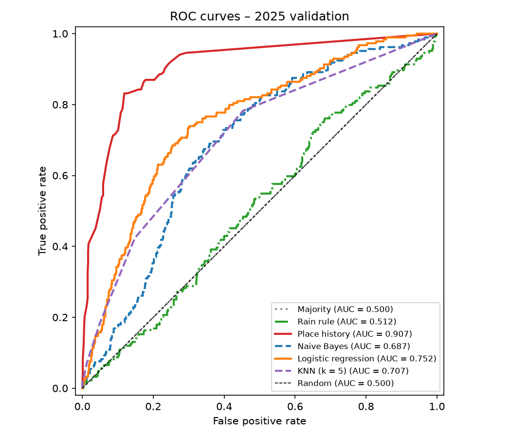
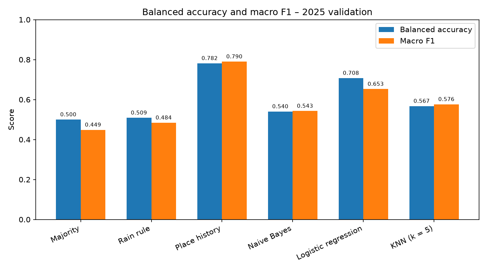
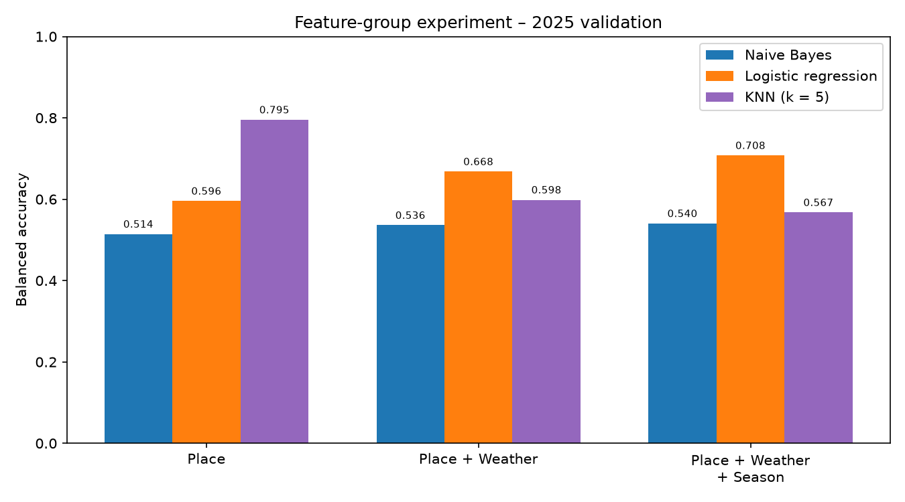
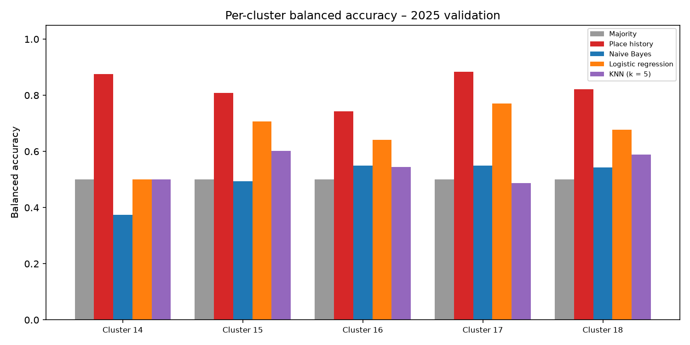
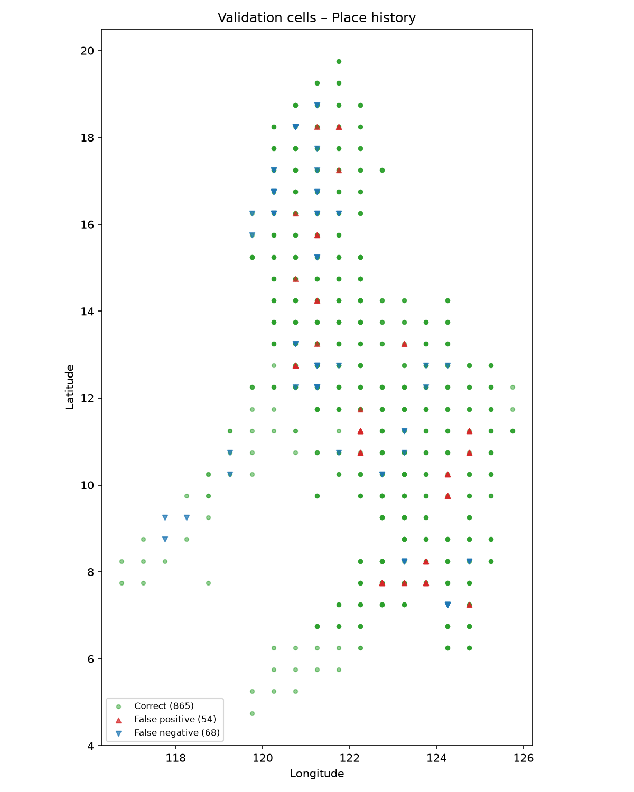

# Weathering With You

CMSC 170 AI Project

## Members

- Simone Pauline M. Dagondon
- Andrew Qlyve Paul C. Bundoc
- Juan Carlos J. Bernardino
- Nicholas O. Pacoma

## Task

Predict whether a 0.5 degree tile in the Philippines flooded in a Sentinel-1 satellite pass, using only the place, the season and the weather before the pass. The plan, features, split and metrics are in [`design.md`](design.md). The data sources, license and column lists are in [`data/README.md`](data/README.md).

## Requirements

- Python 3
- NumPy
- Matplotlib (for generating figures)

Dependencies are listed in `requirements.txt`. Everything else is the Python standard library. There is no pandas and no scikit-learn: the loader, preprocessing, models and metrics are written from scratch.

### Setup

```bash
python3 -m venv .venv
source .venv/bin/activate
pip install -r requirements.txt
```

## Results

All evaluations are performed on the **2025 validation set** (987 rows from 16 Sentinel-1 passes across 5 storm clusters). The **2026 test set (578 rows) was not used for training, tuning, or scoring** and is held out for Milestone 4.

### Main Comparison Table

Source commit `3e8e3e5`. The table compares all three baselines and three machine learning models evaluated on the frozen 2025 validation split:

| Method | Balanced accuracy | Macro F1 | Precision | Recall | ROC AUC | TP | TN | FP | FN | Accuracy |
|---|---:|---:|---:|---:|---:|---:|---:|---:|---:|---:|
| Majority | 0.500000 | 0.448603 | 0.000000 | 0.000000 | 0.500000 | 0 | 803 | 0 | 184 | 0.813576 |
| Rain rule | 0.508853 | 0.484221 | 0.193548 | 0.391304 | 0.512230 | 72 | 503 | 300 | 112 | 0.582573 |
| Place history | 0.781593 | 0.790029 | 0.682353 | 0.630435 | 0.906939 | 116 | 749 | 54 | 68 | 0.876393 |
| Naive Bayes | 0.540372 | 0.542844 | 0.273381 | 0.206522 | 0.686590 | 38 | 702 | 101 | 146 | 0.749747 |
| Logistic regression | 0.707611 | 0.652748 | 0.380062 | 0.663043 | 0.752382 | 122 | 604 | 199 | 62 | 0.735562 |
| KNN (k = 5) | 0.567485 | 0.576422 | 0.459459 | 0.184783 | 0.706556 | 34 | 763 | 40 | 150 | 0.807497 |

### Main Figures

#### 1. ROC Curves and Validation Metrics



#### 2. Feature Groups and Per-Cluster Analysis



#### 3. Spatial Validation Map


### Key Findings

- **Place dominates weather:** A simple 3-day rainfall thresholding rule achieves balanced accuracy of 0.509 and ROC AUC of 0.512 (essentially chance), while the historical place baseline achieves balanced accuracy of 0.782 and ROC AUC of 0.907. Topography and drainage dictate where water accumulates far more than short-term rain accumulation.
- **Why Naive Bayes and Logistic Regression cannot draw a map:**
  - *Gaussian Naive Bayes* fits axis-aligned Gaussians to latitude and longitude independently, creating smooth elliptical contours centered on the map centroid that cannot capture non-convex islands or narrow river basins.
  - *Logistic Regression* forms a single planar dividing boundary across coordinates $(lat, lon)$, unable to isolate localized flood-prone valleys. However, negative weights on elevation and balanced class weights allow it to achieve a competitive 0.708 balanced accuracy.
- **Why KNN finds the same cell in other storms:**
  - On place features alone $(lat, lon, elevation)$, KNN ($k=5$) achieves **0.795 balanced accuracy** and **0.910 ROC AUC**, because the nearest historical rows are the exact same 0.5° tile observed in 2022–2024. Adding 9 noisy weather dimensions dilutes spatial proximity in Euclidean space, dropping KNN's balanced accuracy to 0.567.

## Reproduce the results

Run every command from the repository folder.

The processed dataset, `data/processed/flood_data.csv`, is already in the repository, so steps 1 to 3 are only needed to rebuild it from the raw sources.

1. Download the PhilSA flood shapefiles into `data/raw/` (about 50 minutes, see `data/README.md`):
   ```
   python scripts/download.py
   ```
2. Compute the flooded area per pass and tile into `data/interim/flood_cells.csv` (about a minute), then fetch the NASA POWER weather for each tile into the cache in `data/raw/weather/`:
   ```
   python -m src.cells
   python -m src.weather
   ```
3. Build the processed CSV and the frozen split files in `results/splits/`:
   ```
   python scripts/build_dataset.py
   ```
4. Score the three baselines on the 2025 validation set (`results/runs.csv`):
   ```
   python scripts/run_baselines.py
   ```
5. Train Gaussian Naive Bayes, logistic regression, and KNN on 2022–2024 and evaluate on 2025:
   ```
   python scripts/run_models.py
   ```
6. Build the main comparison table:
   ```
   python scripts/compare.py --commit 3e8e3e5
   ```
   `HEAD` works after rerunning steps 4 and 5. To rebuild the committed table without rerunning, use `--commit 3e8e3e5`.
7. Run the feature-group ablation experiment:
   ```
   python scripts/run_feature_groups.py
   ```
8. Run per-cluster evaluation across storm events:
   ```
   python scripts/run_per_cluster.py
   ```
9. Run flood threshold sensitivity (0.5%, 1.0%, 2.0%):
   ```
   python scripts/run_thresholds.py
   ```
10. Run error analysis breakdown by geography, rain, and elevation:
    ```
    python scripts/run_error_analysis.py
    ```
11. Export validation predictions:
    ```
    python scripts/export_validation_scores.py
    ```
12. Tune classification decision thresholds across the 18-point $\tau$ grid (`results/tables/threshold_tuning.csv`):
    ```
    python scripts/run_threshold_tuning.py
    ```
13. Generate all figures:
    ```
    python scripts/plot_results.py
    ```

Alternatively, run the complete end-to-end reproduction pipeline and verify all artifact checksums with a single command:
```bash
python scripts/run_all.py
```

The runners append to `results/runs.csv` with the recording commit hash. The 2026 test set remains held out until Milestone 4.

## Tests

```
python -m unittest discover -s tests -t .
```

## Layout

| Path | Contents |
|---|---|
| `src/` | Shapefile reader, flooded area per tile, weather fetch, loader, split, preprocessing, metrics, baselines |
| `src/models/` | Gaussian Naive Bayes, logistic regression and K nearest neighbors |
| `scripts/` | Download, dataset build, and the baseline and model runners |
| `data/` | Acquisition list, interim and processed tables (`data/raw/` is not committed) |
| `results/` | Frozen splits, `runs.csv` with one row per run, baseline per-cluster scores, `hyperparameters.md` with the settings and seed of every method |
| `tests/` | Unit tests |
| `task-log.md` | Member contributions per milestone |
| `requirements.txt` | Dependencies (`numpy`, `matplotlib`) |
| `LICENSE` | MIT License |

## Task Log

Member contributions and milestone progress are recorded in [`task-log.md`](task-log.md).

## AI Tool Use Disclosure

AI assistants (Claude, ChatGPT, GitHub Copilot) were consulted for drafting boilerplate code, generating plotting templates, and assisting with documentation drafting. All mathematical logic, metrics (`roc_auc`, `roc_curve`, balanced accuracy, macro F1), data preprocessing, model implementations, and evaluation numbers were verified independently through custom test suites and empirical validation runs.

## License

- **Code:** Licensed under the [MIT License](LICENSE).
- **Flood Inundation Maps:** Provided by the Philippine Space Agency (PhilSA) via the Humanitarian Data Exchange, licensed under Creative Commons Attribution ([CC BY](https://creativecommons.org/licenses/by/4.0/)). Credit: *"Philippine Space Agency (PhilSA), via the Humanitarian Data Exchange"*. See [`data/README.md`](data/README.md) for full details.
- **Meteorological & Surface Data:** Sourced from NASA POWER (Prediction of Worldwide Energy Resources), free to use with credit to the NASA POWER Project.
