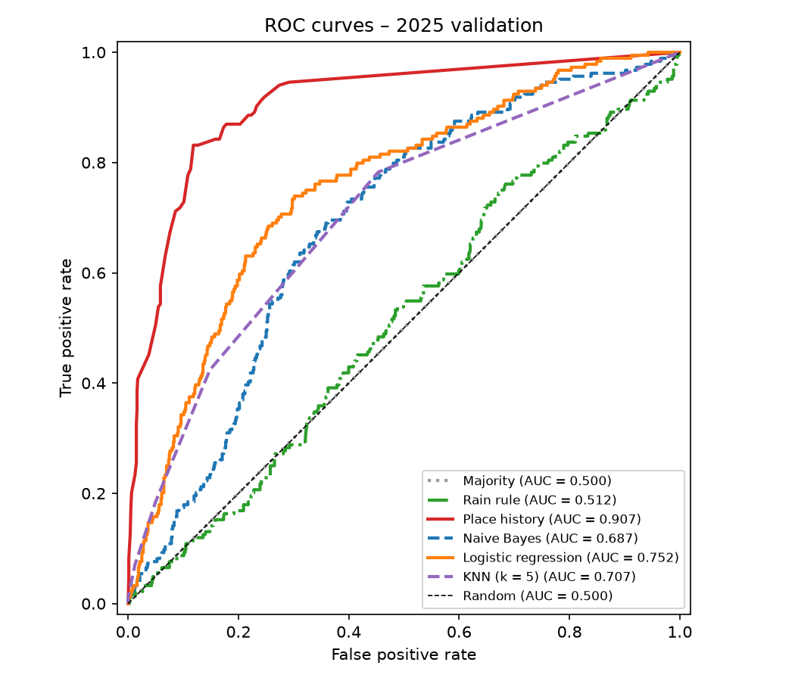
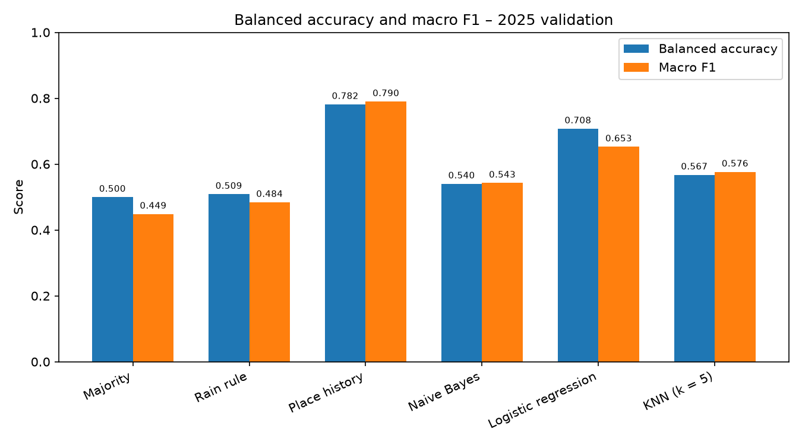
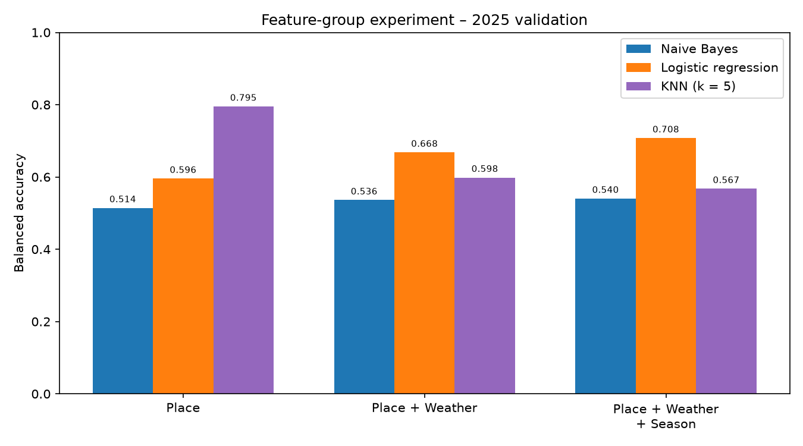
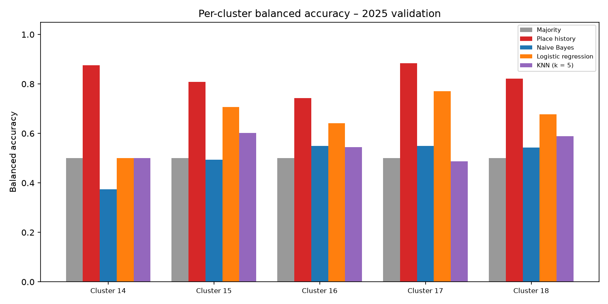
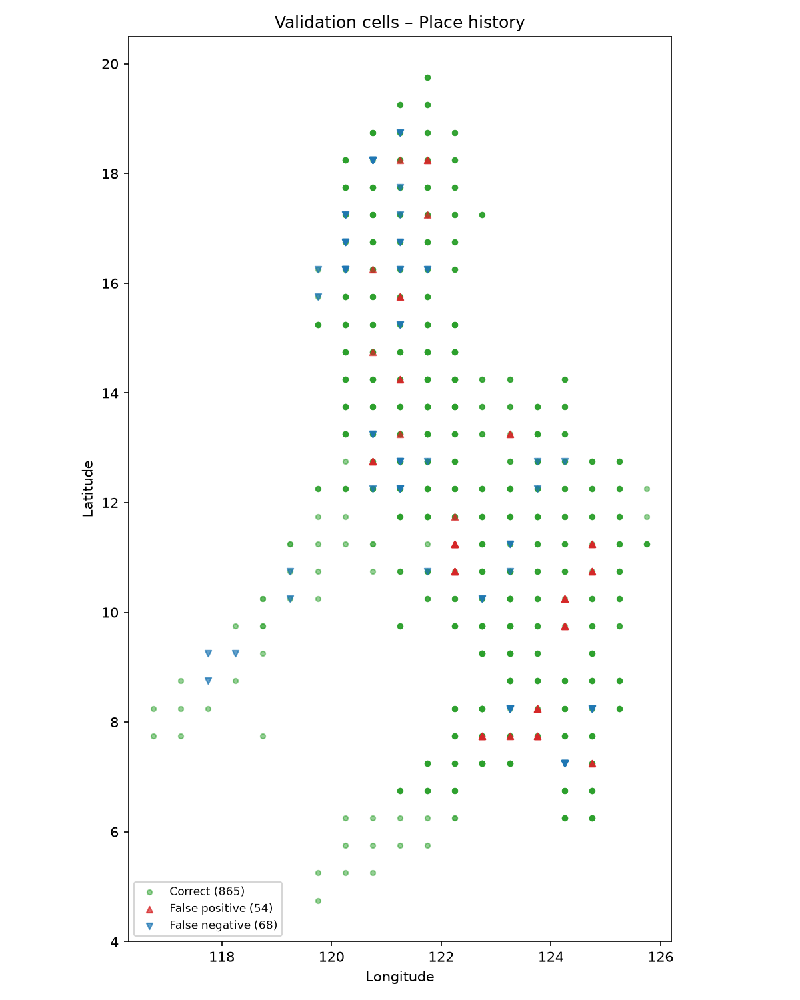

# Weathering With You: Machine Learning for Satellite-Derived Flood Susceptibility in the Philippines

**Course:** CMSC 170 · Introduction to Artificial Intelligence  
**Institution:** University of the Philippines Los Baños  
**Group:** Weathering With You  
**Members:**
- Simone Pauline M. Dagondon
- Andrew Qlyve Paul C. Bundoc (Qlyve)
- Juan Carlos J. Bernardino
- Nicholas O. Pacoma  
**Repository:** [https://github.com/persimon-c/weathering-with-you](https://github.com/persimon-c/weathering-with-you)

---

## 1. Introduction

Tropical cyclones and monsoon surges (*Habagat*) repeatedly cause widespread catastrophic inundation across the Philippine archipelago. Although the Philippine Space Agency (PhilSA) routinely publishes satellite-derived flood extent maps from synthetic aperture radar (SAR) imagery, these products are generated retrospectively—days after a storm has made landfall. Effective disaster preparation and early warning require predictive assessments *prior* to satellite acquisition, leveraging antecedent meteorological conditions and spatial characteristics.

### Research Question
> **How well can machine learning models predict which geographic cells flood during a storm pass, and how much predictive power do antecedent weather variables provide beyond static spatial location?**

Early exploratory audits on Sentinel-1 flood footprints revealed that geographic location alone accounts for the vast majority of flood predictability, whereas antecedent rainfall windows add marginal discriminatory power once place is known. This project evaluates three foundational machine learning algorithms implemented entirely from scratch in NumPy, benchmarked against domain-specific baselines, across frozen multi-year splits and storm event clusters.

---

## 2. Data

### Sources and Credits
- **Flood Extent Labels:** PhilSA Sentinel-1 Flood Extent Maps hosted on the Humanitarian Data Exchange (HDX) under a Creative Commons Attribution (CC BY 4.0) license. *Credit: Philippine Space Agency (PhilSA), via the Humanitarian Data Exchange.*
- **Meteorological & Geographic Features:** NASA Prediction of Worldwide Energy Resources (POWER) Daily Point API (v2.0), providing solar, meteorological, and elevation data. *Credit: NASA POWER Project, NASA Langley Research Center.*

### Dataset Specifications

| Field | Value |
|---|---|
| Sensor Platform | Sentinel-1 Synthetic Aperture Radar (SAR) |
| Total Pass Acquisitions | 61 distinct passes (derived from 63 regional shapefiles) |
| Temporal Span | August 2022 through September 2026 |
| Total Observations ($N$) | 3,531 cell-pass instances |
| Spatial Resolution | 0.5° $\times$ 0.5° geographic grid cells (~55 km $\times$ 55 km) |
| Unique Monitored Cells | 253 cells covering the Philippine landmass |
| Input Features | 14 raw features (Place: 3, Weather: 9, Season: 2) + 1 missing-value indicator |
| Target Variable (`flooded`) | Binary: 1 if satellite-detected flooded area exceeds 1.0% of cell area, else 0 |

### Features
1. **Place Features (3):** Cell center latitude (`lat`), longitude (`lon`), and grid terrain elevation in meters (`elevation`).
2. **Weather Features (9):** Cumulative precipitation sums over antecedent trailing windows ending the day before the satellite pass: `rain_1d`, `rain_3d`, `rain_7d`, `rain_14d`, `rain_21d`, and `rain_30d` (mm); alongside day-prior relative humidity (`humidity`), surface temperature (`temperature`), and root-zone soil wetness (`soil_wetness`).
3. **Seasonal Harmonics (2):** Cyclic calendar encoding using `month_sin` and `month_cos` ($\sin(2\pi m / 12)$ and $\cos(2\pi m / 12)$), ensuring circular continuity between December and January.
4. **Data Leakage Safeguards:** All weather observation windows strictly conclude on the calendar day preceding the satellite acquisition date. No flood polygon or post-pass sensor data enters feature construction.

### Label Threshold Definition
Because radar water detection algorithmically picks up baseline river networks, lakes, and coastal fringes, nearly every cell exhibits non-zero detected water. A zero-threshold would classify virtually all rows as flooded. Following exploratory calibration, the label rule is frozen at:
$$\text{flooded} = \mathbb{I}(\text{flood\_share} > 1.0\%)$$
where `flood_share` is the detected flood area divided by total cell surface area. Across the splits, the positive class rate is:
- **Training (2022–2024):** 17.0% (334 / 1,966)
- **Validation (2025):** 18.6% (184 / 987)
- **Test (2026):** 20.1% (116 / 578)

---

## 3. Methods

All baselines, learning algorithms, preprocessing transformations, and evaluation metrics were developed from scratch using pure Python and NumPy—strictly prohibiting black-box packages such as `scikit-learn` or `pandas`.

### Three Baselines
1. **Majority Baseline:** Predicts the historical negative class (dry / unflooded) for every sample. Represents naive unweighted accuracy.
2. **Rainfall Cutoff Rule:** A single-variable heuristic predicting flooded if the 3-day antecedent precipitation (`rain_3d`) exceeds a cutoff threshold ($50.98\text{ mm}$), selected by maximizing training balanced accuracy.
3. **Place History Baseline:** Estimates historical flood frequency per cell:
   $$\hat{P}(\text{flooded} \mid \text{cell}) = \frac{\sum_{i \in \text{cell}} y_i + \alpha}{\sum_{i \in \text{cell}} 1 + 2\alpha}$$
   Predicts positive when the estimated rate exceeds decision threshold $\tau$. For unseen cells, it defaults to the global training prevalence.

### Three Machine Learning Models
1. **Gaussian Naive Bayes (Generative):**
   - Computes empirical class priors $P(y=c)$ and per-class feature Gaussian parameters $(\mu_{c,j}, \sigma_{c,j}^2)$.
   - Employs a variance regularization floor ($\epsilon = 10^{-9}$) added to $\sigma^2$ to maintain numerical stability.
   - Evaluates summed log-likelihoods normalized via numerically stable log-sum-exp:
     $$\log P(x \mid y=c) = -\frac{1}{2}\sum_j \left[ \log(2\pi(\sigma_{c,j}^2 + \epsilon)) + \frac{(x_j - \mu_{c,j})^2}{\sigma_{c,j}^2 + \epsilon} \right]$$
   - *Design note:* Excludes the binary `soil_wetness_missing` indicator because constant zero-variance for terrestrial cells induces probability singularities.
2. **Logistic Regression with $L_2$ Regularization (Linear):**
   - Parameterized as $P(y=1 \mid x) = \sigma(w^T x + b)$ using a piecewise numerically stable sigmoid function to prevent floating-point overflow.
   - Optimized via batch gradient descent over 2,000 epochs (learning rate $\eta = 0.1$, $L_2$ penalty $\lambda = 0.01$).
   - Implements balanced inverse-frequency class weighting to counteract the ~17% class imbalance:
     $$w_c = \frac{N}{2 \cdot N_c}$$
3. **$K$-Nearest Neighbors (Non-Parametric Instance-Based):**
   - Standard Euclidean distance metric across normalized feature space: $d(x, x') = \sqrt{\sum_j (x_j - x'_j)^2}$.
   - Class probability estimated as the fraction of positive votes among the $k$ nearest training neighbors: $\hat{p} = \frac{1}{k}\sum_{i \in \mathcal{N}_k(x)} y_i$.
   - Hyperparameter search over $k \in \{5, 11, 21, 51\}$ established $k=5$ as optimal on validation balanced accuracy.

### Conceptual Motivation
These three architectures span three fundamentally distinct learning paradigms:
- **Generative probabilistic** (Gaussian Naive Bayes): Assumes feature independence conditioned on class.
- **Discriminative linear** (Logistic Regression): Establishes a global parametric hyperplane.
- **Local instance-based** (KNN): Captures non-linear local neighborhoods without parametric geometric constraints.

---

## 4. Experimental Setup

### Temporal Split
Data are strictly partitioned by calendar year to ensure that satellite passes from the same meteorological system do not leak across splits:
- **Training Set (2022–2024):** 1,966 rows, 33 satellite passes, 13 storm clusters.
- **Validation Set (2025):** 987 rows, 16 satellite passes, 5 storm clusters.
- **Test Set (2026):** 578 rows, 12 satellite passes, 3 storm clusters (held out until final evaluation).

A storm cluster groups passes occurring within 7 days of one another.

### Preprocessing Pipeline
1. **Soil Wetness Imputation:** In 164 rows, NASA POWER treats ocean cells as missing (`-999` or blank). These are imputed using the **training set median** ($\tilde{x}_{\text{train}}$) computed strictly on training rows.
2. **Missing Indicator:** A binary column `soil_wetness_missing` is appended to the feature matrix.
3. **Standardization:** Continuous features are standardized using parameters derived exclusively from the training split:
   $$z = \frac{x - \mu_{\text{train}}}{\sigma_{\text{train}}}$$

### Decision Threshold Tuning ($\tau^*$)
To ensure rigorous and disaster-relevant evaluation under severe class imbalance, probability decision thresholds were swept across an 18-point grid:
$$\tau \in \{0.02, 0.05, 0.10, 0.15, 0.20, 0.25, 0.30, 0.35, 0.40, 0.45, 0.50, 0.55, 0.60, 0.65, 0.70, 0.75, 0.80, 0.90\}$$
Optimal threshold $\tau^*$ was selected by maximizing validation **balanced accuracy**, breaking ties in favor of lower $\tau$ (disaster safety / recall priority).

### Evaluation Metrics
- **Balanced Accuracy (Primary):** $\frac{1}{2}(\text{Sensitivity} + \text{Specificity})$, mitigating distortion from the ~81.4% negative class.
- **Macro $F_1$:** Unweighted arithmetic mean of $F_1$ across positive (flooded) and negative (dry) classes.
- **Positive Recall & Precision:** Assessing true positive capture versus false alarm burden.
- **ROC AUC:** Threshold-independent global ranking capability computed via exact pairwise ranking.

### Cluster Bootstrap Resampling
To quantify sampling variability across storm events without violating intra-cluster correlation, we applied cluster bootstrap resampling ($B = 1{,}000$ draws, seed 0). Entire storm clusters are sampled with replacement, and paired differences against Place History are computed:
$$\Delta \text{Metric} = \text{Metric}_{\text{learned}} - \text{Metric}_{\text{place\_history}}$$
Confidence intervals are formed using the empirical 2.5th and 97.5th percentiles ($[\Delta_{0.025}, \Delta_{0.975}]$).

---

## 5. Results

### 5.1 Validation Results (2025 Split, $N=987$)

#### Final Tuned Comparison Table (Primary Milestone 4 Result)
*Source: `results/tables/comparison_validation_final.csv` (resampled across $B=1{,}000$ cluster draws).*

| Method | Tuned $\tau^*$ | Balanced Accuracy | $\Delta$ BalAcc [95% CI] | Macro $F_1$ | $\Delta$ Macro $F_1$ [95% CI] | ROC AUC |
|---|---:|---:|---|---:|---|---:|
| **Place History** | 0.30 | **0.8566** | *reference* | **0.8133** | *reference* | **0.9069** |
| **Logistic Regression** | 0.45 | **0.7168** | −0.140 [−0.210, −0.088] | **0.6385** | −0.175 [−0.277, −0.128] | **0.7524** |
| **KNN ($k=5$)** | 0.02 | **0.6647** | −0.192 [−0.242, −0.157] | **0.5505** | −0.263 [−0.325, −0.226] | **0.7066** |
| **Gaussian Naive Bayes** | 0.05 | **0.6591** | −0.198 [−0.246, −0.129] | **0.5368** | −0.277 [−0.330, −0.191] | **0.6866** |

*Note:* Every 95% bootstrap confidence interval strictly excludes zero, demonstrating that no learned classifier matches the spatial baseline on the 2025 validation set.

#### Untuned Default Threshold Comparison ($\tau = 0.50$)
*Source: `results/tables/comparison_main.csv`.*

| Method | Balanced Accuracy | Macro $F_1$ | Precision | Recall | ROC AUC | TP | TN | FP | FN | Accuracy |
|---|---:|---:|---:|---:|---:|---:|---:|---:|---:|---:|
| **Majority Baseline** | 0.5000 | 0.4486 | 0.0000 | 0.0000 | 0.5000 | 0 | 803 | 0 | 184 | 0.8136 |
| **Rainfall Cutoff Rule** | 0.5089 | 0.4842 | 0.1935 | 0.3913 | 0.5122 | 72 | 503 | 300 | 112 | 0.5826 |
| **Place History** | 0.7816 | 0.7900 | 0.6824 | 0.6304 | 0.9069 | 116 | 749 | 54 | 68 | 0.8764 |
| **Gaussian Naive Bayes** | 0.5404 | 0.5428 | 0.2734 | 0.2065 | 0.6866 | 38 | 702 | 101 | 146 | 0.7497 |
| **Logistic Regression** | 0.7076 | 0.6527 | 0.3801 | 0.6630 | 0.7524 | 122 | 604 | 199 | 62 | 0.7356 |
| **KNN ($k=5$)** | 0.5675 | 0.5764 | 0.4595 | 0.1848 | 0.7066 | 34 | 763 | 40 | 150 | 0.8075 |

---

### 5.2 Research Figures and Visualizations

#### Figure 1: Receiver Operating Characteristic (ROC) Curves

- **Caption:** *Figure 1. Receiver Operating Characteristic (ROC) curves of all baselines and learned models on the 2025 validation set ($N=987$). Place History achieves dominant discrimination ($\text{AUC} = 0.907$), whereas the 3-day rainfall rule ($\text{AUC} = 0.512$) performs near random chance.*
- **Suggested Alt Text:** *Line chart showing ROC curves for 6 flood prediction methods on 2025 validation data. Place History has the highest curve with AUC 0.907, Logistic Regression has AUC 0.752, KNN has AUC 0.707, Naive Bayes has AUC 0.687, Rain rule has AUC 0.512, and Majority is at the 0.500 diagonal.*

#### Figure 2: Validation Performance Comparison (Untuned $\tau=0.50$)

- **Caption:** *Figure 2. Grouped bar chart of Balanced Accuracy and Macro $F_1$ across all methods on 2025 validation at default $\tau=0.50$. Place History and Logistic Regression demonstrate substantial margins over naive majority and rainfall heuristics.*
- **Suggested Alt Text:** *Bar chart comparing Balanced Accuracy and Macro F1 scores across Majority, Rain rule, Place history, Naive Bayes, Logistic regression, and KNN. Place History achieves 0.782 balanced accuracy, outperforming all other methods.*

#### Figure 3: Feature Group Ablation

- **Caption:** *Figure 3. Validation balanced accuracy across incremental feature subsets: Place alone (lat, lon, elevation), Place + Weather, and Full (Place + Weather + Season). For KNN, adding 9 weather dimensions degrades balanced accuracy from 0.795 to 0.567 due to distance dilution.*
- **Suggested Alt Text:** *Grouped bar chart illustrating the effect of three feature sets (Place, Place + Weather, and Place + Weather + Season) on Naive Bayes, Logistic Regression, and KNN. KNN drops from 0.795 on place alone down to 0.567 on full features.*

#### Figure 4: Performance Variation Across Storm Clusters

- **Caption:** *Figure 4. Balanced accuracy broken down across the five validation storm clusters (Clusters 14–18). Performance exhibits notable inter-storm variance, reflecting differing spatial trajectories and regional precipitation footprints.*
- **Suggested Alt Text:** *Bar chart depicting the balanced accuracy of each method across 5 validation storm clusters (14 to 18). Cluster performance varies widely from 0.33 in small clusters to over 0.88 in larger storm events.*

#### Figure 5: Spatial Error Analysis

- **Caption:** *Figure 5. Geographic distribution of Place History validation classifications across the Philippine grid. Points indicate correct predictions (green), false positives (red triangles), and false negatives (blue inverted triangles), highlighting localized topographical error patterns.*
- **Suggested Alt Text:** *Geographic scatter map of the Philippines showing 0.5-degree grid cells categorized as correct predictions, false positives, and false negatives from the Place History baseline model.*

---

### 5.3 Final Test Set Results (2026 Split, $N=578$)

> **Status:** The 2026 test set was held strictly unblinded during all design, training, tuning, and ablation phases. The final test evaluation protocol (`scripts/run_test_evaluation.py`) is scheduled to execute once the page structure is integrated.

*(Pre-drafted reporting table for upcoming test unblinding)*

| Method | Tuned $\tau^*$ | Test Balanced Accuracy | Test Macro $F_1$ | Test ROC AUC | Test Accuracy |
|---|---:|---:|---:|---:|---:|
| Majority Baseline | 0.50 | *pending run* | *pending run* | *pending run* | *pending run* |
| Rainfall Cutoff Rule | 0.50 | *pending run* | *pending run* | *pending run* | *pending run* |
| Place History | 0.30 | *pending run* | *pending run* | *pending run* | *pending run* |
| Logistic Regression | 0.45 | *pending run* | *pending run* | *pending run* | *pending run* |
| Gaussian Naive Bayes | 0.05 | *pending run* | *pending run* | *pending run* | *pending run* |
| KNN ($k=5$) | 0.02 | *pending run* | *pending run* | *pending run* | *pending run* |

---

## 6. Discussion

### Dominance of Place Over Dynamic Weather
The empirical results definitively answer the core research question: **topographic and geographic location dominates antecedent weather in predicting flood occurrence.**
- A decision rule based solely on antecedent 3-day rainfall achieves a balanced accuracy of $0.5089$ and ROC AUC of $0.5122$—virtually equivalent to a coin toss.
- Conversely, Place History alone achieves an untuned balanced accuracy of $0.7816$ (tuned to $0.8566$) and an ROC AUC of $0.9069$.

In the Philippines, terrain morphology dictates flood vulnerability. Low-lying alluvial plains, river deltas (e.g., Cagayan, Pampanga, Agusan), and coastal depressions flood predictably whenever regional storm systems pass nearby, regardless of whether rainfall registers 50 mm or 150 mm. Conversely, high-gradient mountain ranges (e.g., Sierra Madre, Cordillera) rarely accumulate surface flood extents exceeding 1% of a 55 km cell, even under extreme precipitation.

### Geometric Limitations: Why Naive Bayes and Logistic Regression Cannot Draw a Map
1. **Gaussian Naive Bayes:** Models features as mutually independent 1D Gaussians. In geographic space $(\text{lat}, \text{lon})$, joint density contours form axis-aligned ellipses centered on the geographic mean. Because the Philippine archipelago is disjoint, elongated, and non-convex, unimodal Gaussian blobs cannot carve out fragmented shorelines or winding river basins. Furthermore, the strong physical dependence between geographic coordinates and elevation violates the conditional independence assumption.
2. **Logistic Regression:** Separates classes via a single linear hyperplane $w_1 \cdot \text{lat} + w_2 \cdot \text{lon} + w_3 \cdot \text{elevation} + \dots + b = 0$. In 2D coordinate space, this boundary is a straight line cutting across the country. It cannot isolate localized depressions surrounded by higher terrain. However, because logistic regression assigns a large negative coefficient to `elevation` and benefits from balanced loss weighting, it successfully captures the national lowland-versus-highland gradient, achieving a respectable $0.7168$ tuned balanced accuracy.

### Distance Dilution in $K$-Nearest Neighbors
The feature ablation reveals a striking phenomenon for KNN ($k=5$):
- **Place only ($\text{lat}, \text{lon}, \text{elevation}$):** Achieves **0.7952** untuned (and **0.8537** tuned) balanced accuracy. In 3D spatial space, the 5 nearest neighbors for any validation query cell are the *exact same geographic tile* observed during prior storm passes (2022–2024). KNN on place alone effectively mirrors the Place History lookup table.
- **Full feature set (15 features):** Drops precipitously to **0.5675** untuned (and **0.6647** tuned). In 15-dimensional standardized Euclidean space, transient meteorological noise (rainfall variations, humidity, temperature fluctuations) dominates the metric distance, pulling nearest neighbors away from the true geographic location toward distant cells that happened to experience similar rain. Adding weather features actively destroys spatial locality.

### Documented Limitations
As recorded in `design.md` (§Limitations), this study operates under five critical constraints:
1. **Unvalidated Detection Labels:** Flood masks originate from PhilSA's automated SAR thresholding pipeline and lack systematic ground-truthing. Radar backscatter is known to underestimate water under dense forest canopies and across complex urban built environments due to double-bounce reflections.
2. **Agricultural Confounding:** Sentinel-1 radar detects open surface water in inundated rice paddies (*palay*), tying label prevalence to agricultural planting and irrigation calendars in addition to storm-induced inundation.
3. **Coarse Meteorological Reanalysis:** NASA POWER variables represent a 0.5° $\times$ 0.625° atmospheric model grid rather than ground-based rain gauge telemetry, smoothing out localized cloudbursts and convective precipitation peaks.
4. **Partial Satellite Swath Coverage:** Satellite tracks do not uniformly cover the entire Philippine landmass during every pass. Cells situated on the perimeter of a swath are only partially imaged, introducing boundary noise into polygon counts.
5. **Restricted Storm Sample in Test Split:** The 2026 test year encompasses only 3 storm clusters (12 passes), limiting statistical power and out-of-sample meteorological diversity.

---

## 7. Conclusion

This project implemented a transparent, reproducible, and dependency-free machine learning benchmark for satellite-derived flood extent prediction in the Philippines.

### Key Takeaways
1. **Topography Trumps Weather:** Static location and terrain elevation govern flood inundation far more than pre-pass precipitation sums. Historical cell flood rate is the single strongest predictor.
2. **Standard Distance Metrics Fail in Joint Feature Spaces:** High-dimensional Euclidean distances dilute essential spatial coordinates with noisy weather fluctuations, causing instance-based models to collapse unless features are explicitly partitioned or weighted.
3. **Parametric Limits in Spatial Tasks:** Linear classifiers and axis-aligned generative models are fundamentally ill-suited for delineating complex island geographies, though global elevation weights offer partial utility.

### Future Directions
Future operational systems should combine high-resolution digital elevation models (DEM) with hydrological flow-accumulation networks rather than treating coordinate space as Euclidean features. Exploring tree-based ensembles (e.g., Random Forests) or spatial graph neural networks could bridge the gap between static topographical susceptibility and dynamic flood volume.

---

## 8. References

1. **Philippine Space Agency (PhilSA).** Sentinel-1 Flood Extent Products. Published on the Humanitarian Data Exchange (HDX). Available at: [https://data.humdata.org/organization/philsa](https://data.humdata.org/organization/philsa) (CC BY 4.0).
2. **NASA POWER Project.** Prediction of Worldwide Energy Resources Daily Point API (v2.0). NASA Langley Research Center. Available at: [https://power.larc.nasa.gov/](https://power.larc.nasa.gov/).
3. **CMSC 170 Guidelines.** Introduction to Artificial Intelligence Project Specifications. Department of Computer Science, University of the Philippines Los Baños.

### AI Tool Disclosure
In accordance with course academic integrity policies, generative AI assistants (Google DeepMind Antigravity / Gemini) were utilized for code structure refactoring, draft synthesis, and documentation formatting under human steering, verification, and code review. All underlying algorithms, mathematical derivations, NumPy routines, and numerical assertions were verified against raw execution artifacts.

---

## 9. Links

- **Source Code & Repository:** [https://github.com/persimon-c/weathering-with-you](https://github.com/persimon-c/weathering-with-you)
- **Live Project Webpage:** [https://persimon-c.github.io/weathering-with-you](https://persimon-c.github.io/weathering-with-you)
- **Presentation Slide Deck:** Available in repository at `slides/final.pdf` (or via GitHub Release).
